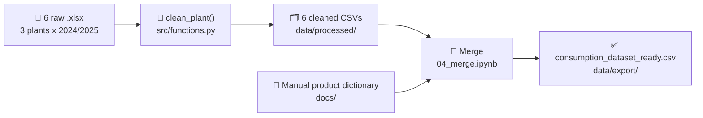

<h1 align="center">🏗️ Consumption Data Pipeline</h1>

<p align="center">
  <b>Six messy Excel exports in, one clean analysis-ready dataset out.</b><br>
  A notebook-based ETL pipeline for material consumption data from three concrete plants (2024-2025).
</p>

<p align="center">
  
  
  
  
  
  
</p>

<p align="center">
  <a href="#-overview">Overview</a> ·
  <a href="#-pipeline">Pipeline</a> ·
  <a href="#-results">Results</a> ·
  <a href="#-key-decisions">Key Decisions</a> ·
  <a href="#-next-steps--limitations">Next Steps & Limitations</a> ·
  <a href="#-repo-contents">Repo Contents</a> ·
  <a href="#-license">License</a>
</p>

---

## 📌 Overview

Each plant exports its consumption records as an Excel report that is not ready for analysis:

- repeated header rows in the middle of the data and total rows at the bottom;
- empty rows, text dates and a technical id column;
- free-text product names (**173 distinct raw spellings**);
- column sets that differ from file to file.

This project cleans each file with **one shared function**, merges them, standardises the product names with a **hand-built dictionary**, and exports a single table that can be loaded into Power BI.

**Stack:** Python 3.11+, pandas, openpyxl, PyYAML, Jupyter.

## 🔄 Pipeline



`clean_plant()` applies the same steps to every file:

1. drops fully empty rows and repeated embedded header rows (`Dosif. m3`);
2. drops the two trailing total rows;
3. parses the date column as a datetime (day-first) and drops rows with invalid future dates (year >= 2026);
4. drops the technical delivery-note id column.

Each plant then gets its own notebook for the steps that are specific to that file.

## 📊 Results

| Metric | Value |
|:--|:--|
| **Input** | 6 raw Excel files (P_A1, P_A2, P_B1 for 2024 and 2025) |
| **Output** | 19,845 rows x 17 columns |
| **Period** | 2024-01-02 to 2025-12-30 |
| **Rows per plant** | P_A1 14,318 · P_A2 2,995 · P_B1 2,532 |
| **Products** | 173 raw names mapped by hand to 108 standard product names |

The output has one row per record with `date`, `plant`, `product`, `note`, `volume` and the consumption of each material (cements, aggregates, water, admixtures, corrective).

> [!NOTE]
> I ran the full chain (`01_testing` to `04_merge`, plus the exploration notebook) in a clean virtual environment on Windows with Python 3.13. The regenerated export is identical to the one in `data/export/`.

## 🧠 Key Decisions

| Decision | Why / how |
|:--|:--|
| **One shared cleaning function** | `clean_plant` lives in `src/` and is imported by every cleaning notebook, so a rule is fixed in one place. |
| **Function tested before use** | `01_testing` runs `clean_plant` on P_A1 2025; its output is the input of `P_A1_25_cleaning`. |
| **Product names standardised manually** | The 173 raw names were exported, mapped by hand and applied with a dictionary. When a name carried an extra remark (e.g. a structural element), it was split with `#` into a separate `note` column instead of being lost (4,258 rows have a note). |
| **Different schemas handled at merge** | Files do not share the same columns (P_B1 2024 has 12, the others 13). The merge keeps all columns and fills missing consumption values with `0.0`. |
| **Dates stay as datetimes** | Kept as datetimes in the cleaning layer; formatting is left to the export. |
| **Config outside the code** | File paths are read from `config/config.yaml`, resolved relative to the project root. |
| **Exploration kept separate** | `05_draft_exploration` flags P_A1 2025 records whose cement consumption deviates more than 20% from their product's median (144 rows). It is a draft and does not feed the final dataset. |

## 🚧 Next Steps & Limitations

**Known limitations**

- The exported CSV still contains **67 fully identical rows**. No step in the pipeline removes duplicates.
- There are **no automated tests or validation checks**. `clean_plant` only prints audit counts.
- `clean_plant` hard-codes the year cut-off (`< 2026`) and the "drop the last 2 rows" rule, and it modifies its input DataFrame in place.
- The merge and the product standardisation are still in notebooks, not in `src/`.

**Next steps**

- [ ] Decide how to handle the 67 duplicate rows (inspect them, then remove or document them).
- [ ] Add tests and validation for `clean_plant` (column contract, date range, duplicate check).
- [ ] Move the merge and product-mapping logic into `src/`.

## 📁 Repo Contents

```text
consumption_project/
├── config/
│   └── config.example.yaml        # template with relative paths; copy to config.yaml (not published)
├── data/
│   ├── raw/                       # original plant Excel exports, 2024 and 2025
│   ├── import/products_years.csv  # lookup table (not read by any notebook at the moment)
│   ├── processed/                 # cleaned per-plant CSVs, merged file, product list, anomaly extract
│   └── export/                    # final dataset: consumption_dataset_ready.csv
├── docs/                          # manual product dictionary used by the merge + two supporting workbooks
├── notebooks/
│   ├── 00_building_cleaning_function.ipynb   # builds the shared cleaning function
│   ├── 01_testing.ipynb                      # tests it on P_A1 2025; feeds P_A1_25_cleaning
│   ├── 02_cleaning_25/                       # one cleaning notebook per plant, 2025
│   ├── 03_cleaning_24/                       # one cleaning notebook per plant, 2024
│   ├── 04_merge.ipynb                        # merge, product standardisation, export
│   └── 05_draft_exploration/                 # draft anomaly analysis of P_A1 2025 cement
├── outputs/
│   ├── column_comparison.csv/.xlsx           # which columns each cleaned file has (CSV written by 04_merge)
│   ├── figures/                              # placeholder, empty for now
│   └── report/                               # placeholder, empty for now
├── scripts/                                  # placeholder, empty for now
├── src/
│   └── functions.py                          # clean_plant, the shared cleaning function
└── requirements.txt                          # pinned dependencies (Python 3.11+)

consumption_journal/                          # my learning journal: pandas notes, code explanations, problems solved
LICENSE                                       # MIT License (code only)
README.md                                     # this file
```

## 📄 License

The code is released under the [MIT License](LICENSE).

The datasets in `data/` are shared with permission from their owner for portfolio purposes only. They are not covered by the MIT License and are not licensed for reuse.
